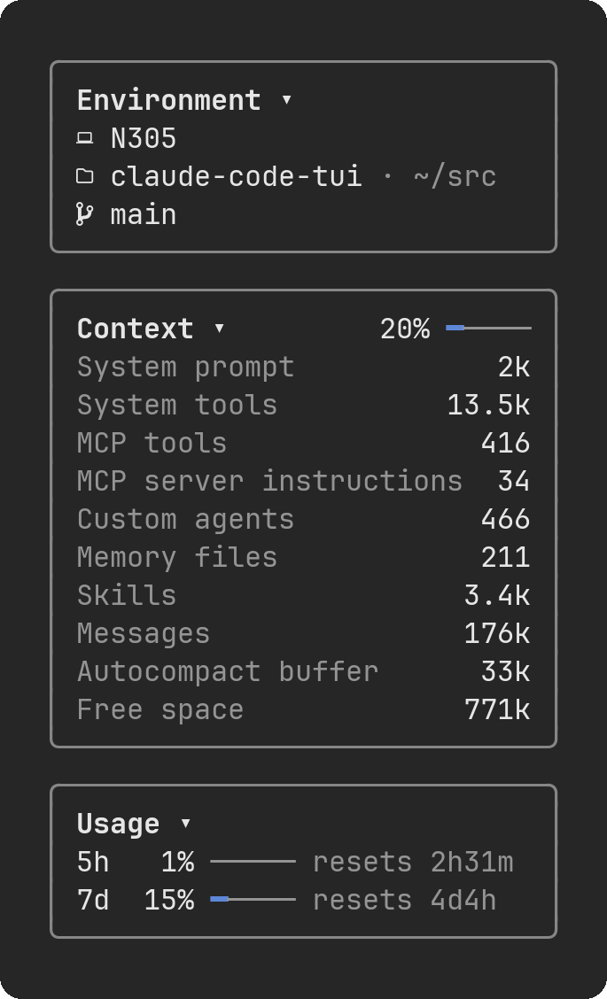

# claude-code-tui

Mods that bring pieces of Claude Desktop's Claude Code UI to the Claude Code CLI.

| Mod | What it adds |
|---|---|
| [session-rail](#session-rail) | A **Session** pane beside the chat: environment, context usage, rate limits, cost by model, and an animated Clawd |

## Requirements

- Claude Code CLI 2.1.308 or newer (mods use the function-hooks plugin API, which is in early access)
- In the terminal, a [Nerd Font](https://www.nerdfonts.com/) for the icons. Claude Desktop and VS Code draw their own icons and bars, so they need nothing extra.
- For the pane to dock beside the chat: the fullscreen layout and a terminal at least 110 columns wide

## Install

At the prompt of a Claude Code terminal session:

```
/plugin install session-rail --marketplace papasaidfine/claude-code-tui
```

Answer `y` to add the marketplace, then pick a scope (user scope loads it in every session). The mod is active right away, no restart needed.

From a shell:

```
claude plugin install session-rail --marketplace papasaidfine/claude-code-tui
```

## session-rail



Type `/rail` to open the pane. It docks beside the chat when the terminal is wide enough, and opens above the prompt otherwise. Close it with its `✕`, or type `/rail` again. `/rail` works while Claude is busy, too: it does not wait for the turn to end.

To have the pane open whenever a session starts, turn on **Open the Session pane at start** in `/config`. It is off by default. Either way, `/rail` still opens and closes it.

Click the arrow beside a card's title (or Tab to it and press Enter while the pane has focus) to fold or unfold it.

### Environment

- The machine's hostname
- The working folder, with its parent (`~` for your home folder)
- The git branch, with `*` when there are uncommitted changes. Hidden outside a git repository.

### Context

How full the context window is. Unfold it to see the breakdown by category (system prompt, tools, messages, free space, ...), the same categories `/context` shows. The breakdown is estimated locally and costs no API request.

Shows `—` until the session has made its first request.

### Usage

Your 5-hour and 7-day rate-limit windows: percent used and time until reset. The percent turns yellow from 80% and red from 95%. A gateway spend limit, if you have one, shows as `spend`.

Rate limits are reported for Claude subscription accounts. With an API key there may be none, and the card shows `No data yet`.

### Cost

What the session has cost so far, the same total `/cost` prints. Unfolded, it lists each model the session used, most expensive first.

The per-model amounts are estimated from each response's token counts at list prices, with prompt-cache writes priced at the 1-hour rate. They can drift from `/cost`'s per-model figures by a little. Spend the mod could not attribute to a model shows as **Other**: requests made before the mod loaded, models it has no price for, small side requests such as session titles, and the premium on fast-mode responses. The total is always the engine's own.

`/clear` starts the count over, as it does for `/cost`.

### Clawd

Clawd, the critter from Claude Code's welcome banner, sits below the cards. While Claude works he keeps busy, one animation after another picked at random: he blinks, looks around, hops, walks, waves or types. When the turn ends he settles down: he blinks now and then, and every so often dozes off, `z`s rising beside his head, until he wakes with a stretch or Claude gets back to work.

He can dress up for the holidays, each with a scene of its own: pick one under **Clawd's theme** in `/config`. He wears his own orange unless you do. The scene keeps moving, whether Claude is working or not.

| Theme | Clawd and his scene |
|---|---|
| `classic` (default) | His own orange |
| `seasonal` | Follows the calendar: `christmas` from Dec 1 to 26, `halloween` from Oct 17 to 31, `lunar-new-year` from a week before Lunar New Year to the Lantern Festival, `classic` the rest of the year |
| `christmas` | Light blue, in a Santa hat, beside a Christmas tree, snow falling |
| `halloween` | White, beside a bare tree, a bat fluttering back and forth overhead |
| `lunar-new-year` | Red, with a gold belt, between two red lanterns, fireworks bursting overhead |

### When it updates

At session start, after every turn, and after every Bash command (so a branch switch or a new change shows up). The Cost card also updates after every model response, subagents' included. The reset countdown is as fresh as the last update.

### The pane background

The docked pane's background is drawn by Claude Code, not the mod, using the theme color `composerSidebarBackground`. To change it, create a custom theme at `~/.claude/themes/<name>.json`:

```json
{
  "name": "Dark (custom sidebar)",
  "base": "dark",
  "overrides": { "composerSidebarBackground": "#2e3440" }
}
```

and pick it with `/theme`. Colors must be `#rrggbb`, `rgb(r, g, b)`, `ansi256(n)` or `ansi:<name>`; there is no transparent value.

## License

[MIT](LICENSE)
